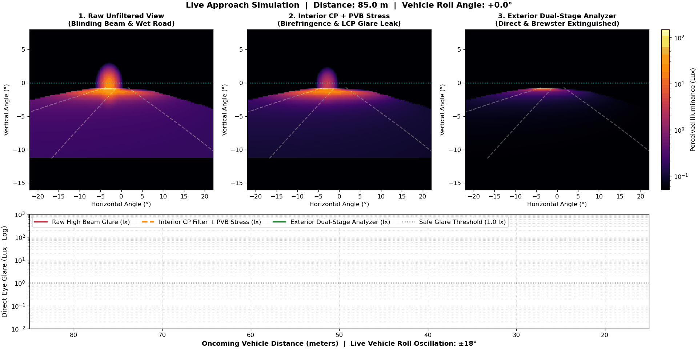

# Dual-Stage Polarized Headlight Glare Mitigation

A computational optics simulation and interactive testbench modeling automotive high-beam glare suppression, laminated windshield stress birefringence, and wet-road Brewster reflection mitigation using **Jones Calculus** and **3D Pinhole Perspective Ray Tracing**.



---

## Overview & Key Engineering Findings

Conventional high-beam headlamps cause severe nocturnal disability glare ($>59\text{ lx}$ at $50\text{ m}$). While passive polarization filtering offers a theoretical solution without mechanical moving parts, naive implementations fail under real-world highway conditions. This project models and resolves three critical optical failure modes:

1. **Vehicle Roll & Banking Misalignment:**
   * Orthogonal linear polarizers ($45^\circ / 135^\circ$) fail when vehicles bank into curves or pitch over road irregularities, leaking glare proportional to $\sin^2(\theta_{\text{tilt}})$ (reaching $25\%$ transmission at $\pm 30^\circ$).
   * **Solution:** Transitioning to **Right-Handed Circular Polarization (RCP)** provides complete rotational invariance ($0.000\%$ roll leakage across all banking angles).

2. **The "Fatal Flaw" of Interior Filters (Windshield Stress Birefringence):**
   * Automotive laminated safety glass contains a strained polyvinyl butyral (PVB) interlayer that acts as an arbitrary wave retarder ($\delta \in [0.05\pi, 0.35\pi]$).
   * Mounting the circular analyzer inside the cabin (e.g., driver glasses or interior visor film) allows the stressed windshield to convert incident RCP waves into **elliptical polarization** *before* filtering, leaking up to $8.74\text{ lx}$ of blinding glare.
   * **Solution:** Mounting the circular analyzer on the **exterior optical surface** extinguishes oncoming RCP glare to $0.06\text{ lx}$ ($>99.9\%$ extinction) prior to glass transmission.

3. **Wet-Road Specular Glare & Handedness Inversion:**
   * Water films on asphalt replace diffuse Lambertian scattering with forward Fresnel specular reflection. A single dielectric bounce reverses circular handedness ($\text{RCP} \to \text{LCP}$), allowing wet-road glare to bypass a single-stage RCP analyzer completely.
   * **Solution:** A **Dual-Stage Analyzer** cascading an exterior RCP extinction stage with a **Vertical Linear Polarizer** eliminates both direct high-beam glare and horizontally $s$-polarized Brewster-angle ($\theta_B \approx 53^\circ$) puddle reflections.

---

## Mathematical Framework (Jones Calculus)

The optical pipeline cascades $2 \times 2$ complex Jones matrices to evaluate output electric field vectors $\mathbf{E}_{\text{out}}$ and retinal illuminance $I \propto \vert{}\mathbf{E}_{\text{out}}\vert{}^2$:

$$\mathbf{E}_{\text{RCP}} = \frac{1}{\sqrt{2}} \begin{pmatrix} 1 \\ -i \end{pmatrix}, \quad \mathbf{J}_{\text{QWP}}(0^\circ) = e^{i\pi/4} \begin{pmatrix} 1 & 0 \\ 0 & -i \end{pmatrix}, \quad \mathbf{J}_{\text{Windshield}}(\delta) = \mathbf{R}(-\phi) \begin{pmatrix} e^{i\delta/2} & 0 \\ 0 & e^{-i\delta/2} \end{pmatrix} \mathbf{R}(\phi)$$

* **Interior Mount Sequence (Leaks Glare):** $\mathbf{E}_{\text{out}} = \mathbf{J}_{\text{Analyzer}} \cdot \mathbf{J}_{\text{Windshield}}(\delta) \cdot \mathbf{E}_{\text{RCP}}$
* **Exterior Mount Sequence (Zero Stress Leakage):** $\mathbf{E}_{\text{out}} = \mathbf{J}_{\text{Windshield}}(\delta) \cdot \mathbf{J}_{\text{Analyzer}} \cdot \mathbf{E}_{\text{RCP}}$

---

## Comparative Performance Summary

| Optical Configuration | Direct Glare at $50\text{ m}$ (Lux) | Roll Invariance ($\pm 30^\circ$) | Wet-Road Brewster Suppression | Status |
| :--- | :---: | :---: | :---: | :---: |
| **1. Raw Unfiltered High Beam** | $59.700\text{ lx}$ | N/A | None | Blinding Hazard |
| **2. Linear Polarizer ($10^\circ$ Roll)** | $1.800\text{ lx}$ | Fails ($\propto \sin^2\theta$) | Partial | Discomfort Glare |
| **3. Interior CP + PVB Stress** | $8.743\text{ lx}$ | Invariant | Fails ($\text{RCP} \to \text{LCP}$ flip) | Birefringence Leak |
| **4. Single-Stage Exterior CP** | $0.060\text{ lx}$ | Invariant | Fails ($\text{RCP} \to \text{LCP}$ flip) | Wet-Road Glare Leak |
| **5. Exterior Dual-Stage Analyzer** | $0.060\text{ lx}$ | Invariant | $>99.5\%$ Extinguished | **Optimal (< 1.0 lx)** |

---

## Repository Structure

* `app.py` — Interactive **Streamlit** optical testbench with real-time sliders for vehicle distance, banking angle, PVB retardance, road wetness, and live polarization ellipse plotting.
* `glare_animation.py` — Standalone **Matplotlib `FuncAnimation`** script simulating an oncoming vehicle approaching from $85\text{ m}$ to $15\text{ m}$ while rolling $\pm 18^\circ$, with synchronized retinal glare telemetry.
* `polarization_project.ipynb` — Core Jupyter Notebook containing static Jones matrix verifications, spatial road illuminance heatmaps, and BB84 quantum polarization sifting models.
* `requirements.txt` — Python package dependencies for local execution and cloud deployment.

---

## Quick Start & Installation

1. **Clone the repository:**
   ```bash
   git clone [https://github.com/YOUR_USERNAME/YOUR_REPO_NAME.git](https://github.com/YOUR_USERNAME/YOUR_REPO_NAME.git)
   cd YOUR_REPO_NAME
   ```

2. **Install dependencies:**
   ```bash
   pip install -r requirements.txt
   ```

3. **Launch the interactive Streamlit dashboard:**
   ```bash
   streamlit run app.py
   ```

4. **Run or export the approach animation:**
   ```bash
   python glare_animation.py
   ```